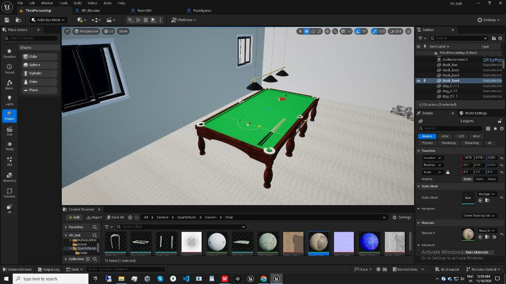
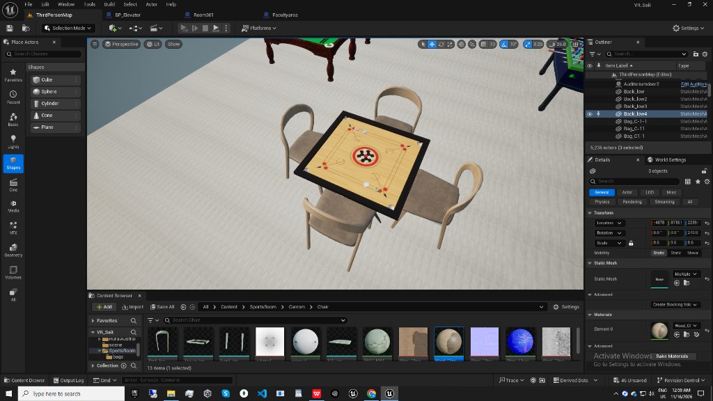
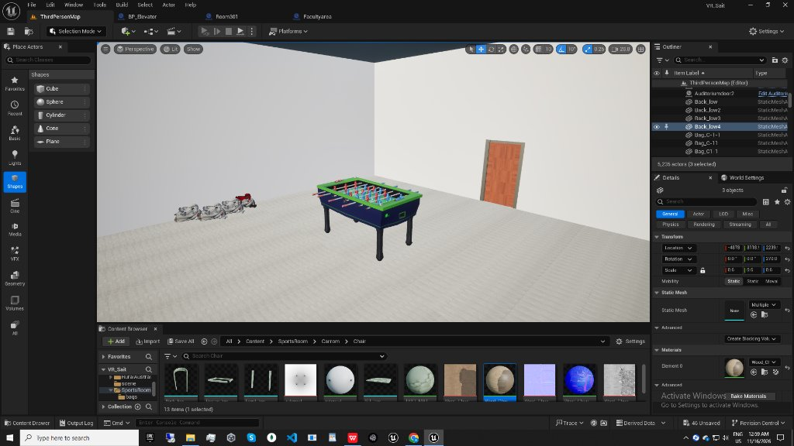
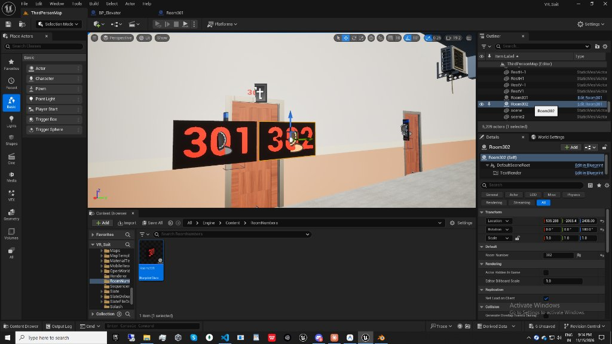
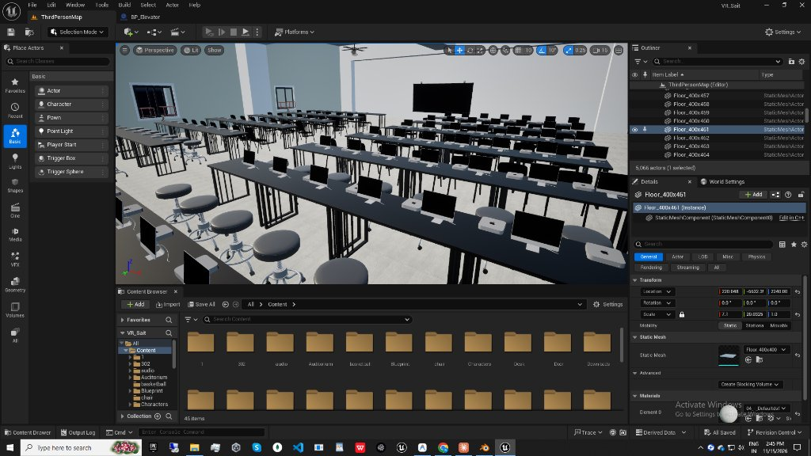

# 🥽 VR_Sait — Virtual Reality Digital Twin of SAIT Indore

[](https://www.unrealengine.com/)
[](https://www.meta.com/quest/)
[](https://www.khronos.org/openxr/)
[](https://github.com/Amaan-Multani)

> An immersive, highly-optimized 3D Virtual Reality Digital Twin of **Sri Aurobindo Institute of Technology (SAIT), Indore**, built using **Unreal Engine 5**. Designed for real-time campus navigation, interactive facilities exploration, and low-latency standalone VR deployment on Meta Quest / PC VR.

---

## 📸 In-Engine Previews

| Billiards & Snooker Arena (Room 312) | Carrom & Indoor Social Area |
|:---:|:---:|
|  |  |

| Foosball & Recreation Zone | Dynamic Parameterized Signboards |
|:---:|:---:|
|  |  |

| High-Density Computer Laboratory (Room 302) |
|:---:|
|  |

---

## 🎯 Key Project Highlights

- **Campus Architectural Digital Twin:** Precise 1:1 scale architectural recreation of SAIT academic blocks, faculty corridors, auditoriums, and dedicated laboratories.
- **Interactive Elevator System (`BP_Elevator`):** Fully operational multi-floor elevator blueprint with door animations, trigger volumes, and physics-driven vertical carriage dispatch.
- **Smart Parameterized Room Signs (`Room301` BP):** Custom modular sign Blueprint leveraging dynamic `TextRender` components and Construction Scripts with exposed instance variables to dynamically number rooms (301 to 312) from a single master asset.
- **Dedicated Student Sports Arena (Room 312):** Features high-fidelity interactive sports setups including standard regulation Snooker/Billiards table with localized pendant illumination, quad-chair Carrom board, Foosball station, and boxing equipment.
- **VR Locomotion Suite:** OpenXR-compliant Teleport Locomotion with boundary check, Snap-turn, smooth joystick locomotion, and VR collision boundaries preventing camera clipping through walls.

---

## ⚡ Performance Optimization & VR Engineering

Virtual Reality on standalone head-mounted displays (HMDs like Meta Quest) requires consistent **72–90 FPS** with zero frame drops to prevent motion sickness. This project incorporates rigorous technical optimizations:

1. **Aggressive Primitive Occlusion via `CullDistanceVolume`:**
   - Precomputed distance culling rules hide small and medium static props outside the immediate viewing frustum.
   - Verified via in-engine performance profiling (`stat initviews`): **~4,615 occluded primitives out of ~5,842 total primitives (~80% GPU draw call reduction)**.
2. **Forward Shading Pipeline:**
   - Configured with `r.ForwardShading=True` for high-frequency MSAA anti-aliasing essential for sharp VR text and thin wireframe/railing clarity without Temporal Anti-Aliasing (TAA) ghosting.
3. **Instanced Stereo & Mobile Multi-View:**
   - Single-pass stereo rendering (`vr.InstancedStereo=True` and `vr.MobileMultiView=True`) drastically cutting CPU draw thread overhead by rendering both left and right eye buffers in a unified pass.

---

## 🛠️ Tech Stack & Tools

- **Engine:** Unreal Engine 5.5.4
- **Language & Scripting:** Unreal Blueprints Visual Scripting, Python (Blender procedural asset generation)
- **3D Modeling & CAD:** Blender 5.1, Fab / Quixel Megascans PBR workflows
- **Target HMDs:** Meta Quest 2 / Quest 3 / Quest Pro / SteamVR compatible headsets
- **API Standard:** OpenXR, DirectX 12 / Vulkan SM6

---

## 📁 Project Architecture

```
VR_Sait/
├── Config/               # Engine renderer, input mappings, and VR target settings
│   ├── DefaultEngine.ini # Forward shading, instanced stereo, OpenXR configs
│   └── DefaultInput.ini  # VR controller input actions and axis mappings
├── Content/              # Primary Unreal Engine assets
│   ├── SportsRoom/       # Snooker, Foosball, Carrom, and sports props
│   ├── RoomNumbers/      # Modular parameterized room number Blueprints
│   ├── PCsetup/          # Computer lab workstations, monitors, seating
│   ├── LIFT/             # Elevator shaft, doors, and control mechanics
│   └── ThirdPerson/      # ThirdPersonMap (Digital Twin master level)
├── Screenshots/          # High-resolution architectural and interactive previews
└── VR_Sait.uproject      # Unreal Engine project descriptor
```

---

## 👨‍💻 Developer & Credits

**Mohd Amaan Multani**  
- **Degree:** B.Tech Computer Science & Engineering (4th Year)  
- **Institution:** Sri Aurobindo Institute of Technology (SAIT), Indore  
- **GitHub:** [@Amaan-Multani](https://github.com/Amaan-Multani)  
- **Specialization:** Virtual Reality (VR), Game Development & Core Java/Algorithms

---

> *Built as an academic Major Project digital twin demonstrating the integration of immersive computing in educational infrastructure.*
